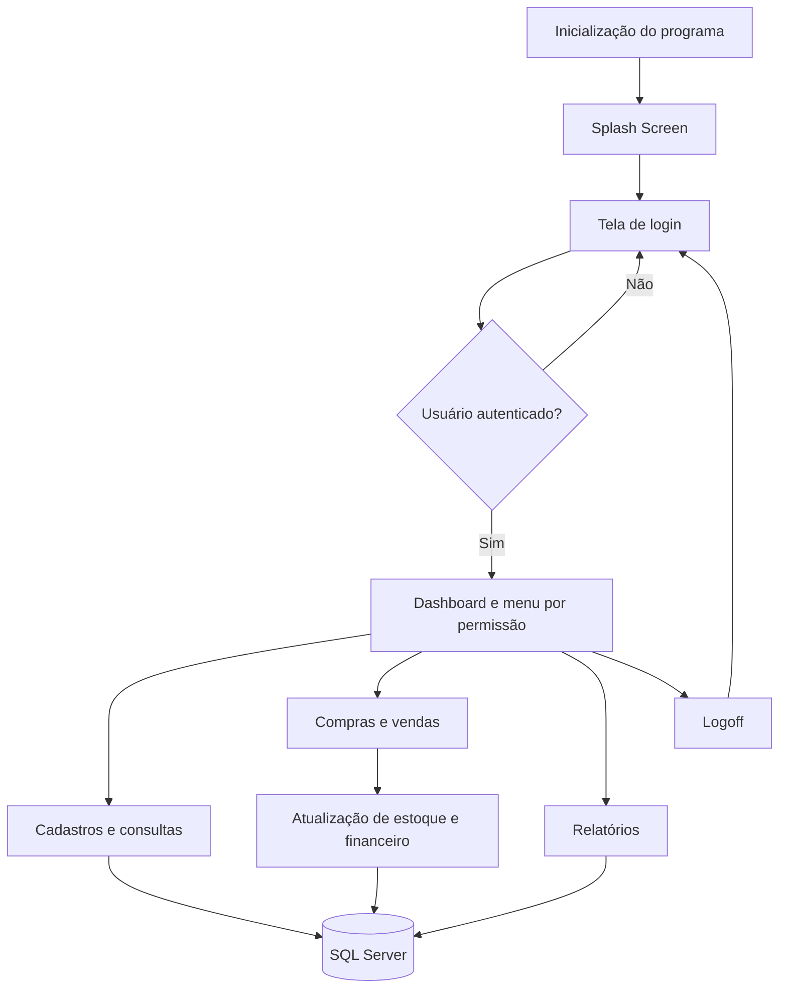
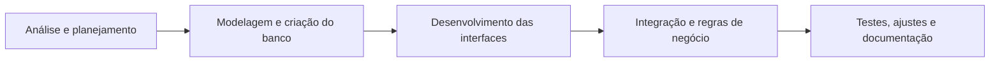

<p align="center">
  
</p>

<h1 align="center">SystemLivraria</h1>

<p align="center">
  <strong>Sistema de gerenciamento de livraria desenvolvido em C# e Windows Forms.</strong><br>
  Projeto acadêmico de Desenvolvimento de Sistemas, com integração ao SQL Server, controle comercial e relatórios gerenciais.
</p>

<p align="center">
  
  
  
  
  
</p>

<p align="center">
  <a href="#sobre-o-projeto">Sobre</a> ·
  <a href="#funcionalidades">Funcionalidades</a> ·
  <a href="#tecnologias-utilizadas">Tecnologias</a> ·
  <a href="#instalacao-e-execucao">Instalação</a> ·
  <a href="#banco-de-dados">Banco de dados</a> ·
  <a href="#relatorios">Relatórios</a>
</p>


---

## Sobre o projeto

O **SystemLivraria** é uma aplicação desktop para apoiar a administração de uma livraria. O sistema centraliza informações de produtos, autores, editoras, clientes, fornecedores, funcionários e usuários e reúne operações de **compra, venda, estoque, consultas e acompanhamento financeiro** em uma única interface.

O projeto foi desenvolvido no contexto do curso técnico de **Desenvolvimento de Sistemas**, aplicando conhecimentos de análise de requisitos, modelagem de dados, desenvolvimento de interfaces, programação orientada a objetos, integração com banco de dados e trabalho em equipe.

### Objetivos

- Organizar o cadastro e a consulta das informações da livraria.
- Registrar compras e vendas com seus respectivos itens e valores.
- Controlar quantidades em estoque, incluindo entradas, saídas e histórico.
- Associar operações comerciais aos registros financeiros.
- Permitir diferentes acessos conforme o perfil do usuário.
- Disponibilizar relatórios para apoio ao acompanhamento das atividades.

> **Escopo:** trata-se de uma **aplicação Windows Forms**, e não de um site ou serviço web. Ela depende de um servidor SQL Server acessível para utilizar os dados do sistema.

## Funcionalidades

### Autenticação e gerenciamento de usuários

- Tela de abertura (*splash screen*) e tela de login.
- Autenticação de usuários ativos cadastrados no banco de dados.
- Painel inicial com informações da sessão, identificação do usuário e horário.
- Controle de acesso por níveis de permissão.
- Cadastro, edição, ativação/desativação e redefinição de senha de usuários por administrador.
- Associação de cada conta a um funcionário e a um perfil de permissão.
- Opção de sair da conta (*logoff*) sem precisar encerrar a aplicação.

### Cadastros

A aplicação possui telas de cadastro e manutenção para as seguintes entidades:

| Módulo | Informações e finalidade |
| --- | --- |
| **Produtos** | Registro de livros/produtos, título, preço, ISBN e vínculos com autor, categoria e editora. |
| **Autores** | Cadastro e identificação de autores. |
| **Editoras** | Cadastro de editoras e dados de contato. |
| **Clientes** | Dados cadastrais utilizados na realização de vendas. |
| **Fornecedores** | Dados de fornecedores utilizados nas compras e na organização de estoques. |
| **Funcionários** | Informações de colaboradores e cargos. |
| **Usuários** | Credenciais, funcionário vinculado, nível de acesso e situação da conta. |

O banco de dados também contém a entidade **Categorias**, usada na classificação dos produtos. Sua existência no banco não significa que exista uma tela independente de cadastro de categorias nesta versão.

### Compras e vendas

As telas comerciais permitem selecionar o parceiro da operação (cliente ou fornecedor), adicionar produtos e quantidades, informar preços quando aplicável, visualizar subtotais e confirmar a operação.

**Em uma venda**, o sistema:

1. Valida o usuário, o cliente, os produtos e os valores informados.
2. Verifica a disponibilidade do estoque e impede a saída de quantidades insuficientes.
3. Registra a venda e seus itens, abatendo as quantidades correspondentes do estoque.
4. Confere o valor total registrado no banco de dados.
5. Gera o lançamento financeiro relacionado à operação.

**Em uma compra**, o sistema:

1. Valida o fornecedor e os itens da compra.
2. Registra a compra e os respectivos itens.
3. Acrescenta os produtos ao estoque do fornecedor, criando o registro de estoque quando necessário.
4. Registra o compromisso financeiro associado à compra.

As operações comerciais utilizam **transações SQL**, de modo que alterações relacionadas sejam confirmadas em conjunto ou revertidas em caso de falha. A interface também permite indicar uma operação como quitada, com o registro de pagamento ou recebimento no financeiro.

### Estoque

- Consulta de produtos e quantidades disponíveis.
- Controle de quantidades por produto e fornecedor.
- Definição de estoques mínimo e máximo no modelo de dados.
- Atualização de saldos após compras e vendas.
- Histórico das alterações de quantidade por meio de trigger do banco de dados.
- Identificação de situações como falta de estoque ou quantidade abaixo do mínimo.

### Consultas e exclusões

- Consultas de dados em tabelas autorizadas para o perfil de usuário.
- Filtros como **Todos**, **Começa com**, **Termina com** e **Igual a**.
- Tela de exclusões com restrições de acesso conforme o nível da conta.

### Relatórios

O sistema possui visualização de relatórios por meio de **Microsoft ReportViewer** e definições **RDLC**, incluindo:

- Estoque atual.
- Movimentações comerciais de estoque por período.
- Entradas financeiras realizadas.
- Saídas financeiras realizadas.
- Fluxo de caixa realizado.

Alguns relatórios são montados dinamicamente no código C#, enquanto o projeto também contém modelos `.rdlc` versionados. Mais detalhes em [Relatórios](#relatorios).

## Perfis de acesso

O sistema trabalha com três níveis identificados no código:

| Nível | Perfil | Acesso geral |
| :---: | --- | --- |
| **1** | **Administrador** | Gerenciamento mais amplo do sistema, incluindo usuários, fornecedores, operações, consultas e relatórios financeiros. |
| **2** | **Gerente** | Operações comerciais, cadastros permitidos, consultas ampliadas e relatórios de estoque. Possui restrições para fornecedores e relatórios financeiros. |
| **3** | **Funcionário** | Acesso operacional limitado, com consultas restritas e sem acesso às áreas de relatórios e exclusão. |

> As permissões são aplicadas nas interfaces e também verificadas em serviços importantes, como autenticação e registro de compras/vendas. As permissões específicas podem variar de uma tela para outra.

## Como o programa funciona

O fluxo geral da aplicação começa no ponto de entrada `Program.cs`:



### Organização da aplicação

A estrutura encontrada no repositório pode ser entendida em três partes principais:

1. **Interface:** formulários Windows Forms para login, navegação, cadastros, consultas, operações comerciais e relatórios.
2. **Regras de negócio:** classes C# que validam dados, autenticam usuários e coordenam compras e vendas, incluindo o controle transacional.
3. **Persistência:** comunicação com o SQL Server por meio de ADO.NET / `System.Data.SqlClient`, consultas SQL, estruturas de dados e objetos do banco.

Essa separação é **uma descrição lógica**, e não uma afirmação de que todo o código esteja organizado em uma arquitetura de camadas rigorosamente isoladas.

## Tecnologias utilizadas

| Categoria | Tecnologia | Aplicação no projeto |
| --- | --- | --- |
| Linguagem | **C#** | Implementação das interfaces, validações e regras de negócio. |
| Plataforma | **.NET Framework 4.7.2** | Framework de execução e compilação da aplicação. |
| Interface | **Windows Forms (WinForms)** | Janelas, formulários, menus, tabelas e componentes visuais. |
| Banco de dados | **Microsoft SQL Server** | Armazenamento dos registros e execução das operações de dados. |
| Acesso a dados | **ADO.NET / System.Data.SqlClient** | Conexões, comandos SQL, parâmetros e transações. |
| Relatórios | **Microsoft ReportViewer (WinForms)** | Pré-visualização e recursos de exportação disponibilizados pelo controle. |
| Modelos de relatório | **RDLC** | Definição de layout e apresentação dos dados nos relatórios locais. |
| Configuração | **App.config / System.Configuration** | Configuração da conexão com o banco de dados. |
| Dados tipados | **DataSet / TableAdapter** | Estruturas de dados utilizadas em partes do projeto. |
| Dependências | **NuGet** | Gerenciamento dos pacotes externos. |
| Desenvolvimento | **Visual Studio** | Edição, compilação e depuração do projeto. |
| Versionamento | **Git e GitHub** | Controle de versões e colaboração da equipe. |

### Pacotes NuGet registrados

As seguintes versões constam em `packages.config`:

| Pacote | Versão |
| --- | --- |
| `Microsoft.ReportingServices.ReportViewerControl.Winforms` | `150.1652.0` |
| `Microsoft.SqlServer.Server` | `1.0.0` |
| `Microsoft.SqlServer.Types` | `170.1000.7` |

Além dos pacotes, o projeto utiliza bibliotecas da própria plataforma .NET, como `System.Windows.Forms`, `System.Data`, `System.Drawing` e `System.Configuration`.

## Banco de dados

O sistema utiliza um banco relacional **SQL Server**, identificado nas configurações e nos scripts do projeto como `db_250064`.

### Principais tabelas

| Grupo | Tabelas e responsabilidade |
| --- | --- |
| Catálogo | `Produtos`, `Autores`, `Editoras`, `Categorias` — informações e classificação dos livros/produtos. |
| Pessoas e parceiros | `Cliente`, `Fornecedores`, `Funcionarios` — entidades ligadas às atividades comerciais. |
| Autenticação | `Usuarios`, `Permissoes` — credenciais, funcionários vinculados e níveis de acesso. |
| Vendas | `Vendas`, `Itens_Vendas` — operações de saída e seus produtos. |
| Compras | `Compras`, `Itens_CMP` — entradas de mercadorias e respectivos itens. |
| Estoque | `Estoque`, `Historico_Estoque` — saldos e registro de alterações de quantidade. |
| Financeiro | `Financeiro`, `Movimentacoes_Financeiro`, `Historico_Financeiro` — contas, pagamentos/recebimentos e histórico. |

### Relacionamentos principais

- **Produto → Autor, Editora e Categoria:** associação de informações bibliográficas.
- **Produto + Fornecedor → Estoque:** controle de quantidade por combinação de produto e fornecedor.
- **Cliente → Venda → Itens da venda:** identificação da venda e dos produtos comercializados.
- **Fornecedor → Compra → Itens da compra:** identificação da entrada de mercadorias.
- **Funcionário → Usuário → Permissão:** associação entre funcionário, credenciais e nível de acesso.
- **Compra/Venda → Financeiro → Movimentações financeiras:** vínculo da operação comercial com seus pagamentos ou recebimentos.

O esquema efetivo depende da **versão de banco instalada**; o código C# atual utiliza algumas colunas adicionadas após a criação inicial das tabelas.

### Objetos SQL usados no projeto

O diretório [`sql_archives`](SystemLivraria/SystemLivraria/sql_archives) reúne materiais do banco, entre eles:

| Arquivo | Conteúdo |
| --- | --- |
| [`TABLES_LIVRARIA.sql`](SystemLivraria/SystemLivraria/sql_archives/TABLES_LIVRARIA.sql) | Estrutura inicial de tabelas e parte dos ajustes de esquema. |
| [`inserts.sql`](SystemLivraria/SystemLivraria/sql_archives/inserts.sql) | Inserções e dados de exemplo para desenvolvimento. |
| [`views.sql`](SystemLivraria/SystemLivraria/sql_archives/views.sql) | Consultas consolidadas por meio de *views*. |
| [`procs.sql`](SystemLivraria/SystemLivraria/sql_archives/procs.sql) | *Stored procedures* para operações e consultas. |
| [`func.sql`](SystemLivraria/SystemLivraria/sql_archives/func.sql) | Funções SQL, como cálculo de subtotal e status de estoque. |
| [`tgr.sql`](SystemLivraria/SystemLivraria/sql_archives/tgr.sql) | Triggers de histórico de estoque e financeiro. |
| [`DerLivraria.pdf`](SystemLivraria/SystemLivraria/sql_archives/DerLivraria.pdf) | Material de referência do modelo entidade-relacionamento. |

**Atenção sobre a instalação do banco:** os arquivos em `sql_archives` funcionam como um **acervo de scripts e versões de desenvolvimento**, não como um instalador único, revisado e executável do início ao fim. Por exemplo, a estrutura inicial de `Financeiro` não apresenta todas as colunas que o serviço comercial atual espera, e o código exige a trigger `trg_AtualizarValorTotal`, além de `trg_HistoricoEstoque` e `trg_HistoricoFinanceiro`. Portanto, **não execute todos os arquivos indiscriminadamente ou suponha que o SQL inicial, sozinho, produza um banco compatível**.

Para reproduzir o ambiente, utilize um **script consolidado e compatível com a versão atual do programa** ou uma cópia autorizada da estrutura mais recente do banco, revisando as dependências antes de aplicar dados de teste.

## Instalação e execução

### 1. Pré-requisitos

Para abrir e executar o projeto a partir do código-fonte, recomenda-se:

- **Windows**, por se tratar de uma aplicação Windows Forms com .NET Framework.
- **Visual Studio 2022 atualizado**, com suporte ao arquivo de solução `.slnx` e a carga de trabalho **Desenvolvimento para desktop com .NET**.
- **.NET Framework 4.7.2 Developer Pack / Targeting Pack**, necessário para compilar para a versão utilizada no projeto.
- **SQL Server** disponível localmente ou em servidor acessível (por exemplo, Express ou Developer em ambiente de desenvolvimento).
- **SQL Server Management Studio (SSMS)** para configurar e inspecionar o banco de dados.
- **Git**, se desejar clonar o código pela linha de comando.
- Acesso à restauração dos pacotes **NuGet**.

### 2. Clonar o repositório

Abra um terminal e execute:

```bash
git clone https://github.com/LivrariaProjeto/SystemLivraria.git
cd SystemLivraria
```

Também é possível baixar o código como ZIP pela página do repositório.

### 3. Preparar o SQL Server

1. Instale ou acesse uma instância do **SQL Server**.
2. Conecte-se a essa instância usando o **SSMS**.
3. Obtenha a estrutura **atualizada e compatível** do banco `db_250064` junto aos responsáveis pelo banco de dados do projeto.
4. Crie/restaure o banco e aplique os scripts compatíveis, respeitando as dependências entre tabelas, colunas, *views*, *procedures* e *triggers*.
5. Confira se existe um **usuário administrativo ativo e provisionado de forma segura** para permitir o primeiro login. O repositório não deve ser tratado como fonte de credenciais padrão.
6. Teste se a conta de conexão utilizada pelo programa possui as permissões SQL necessárias às operações previstas.

Para conferir alguns elementos essenciais, execute no banco correto:

```sql
USE db_250064;
GO

SELECT name
FROM sys.triggers
WHERE name IN (
    'trg_AtualizarValorTotal',
    'trg_HistoricoEstoque',
    'trg_HistoricoFinanceiro'
);

SELECT TABLE_NAME, COLUMN_NAME
FROM INFORMATION_SCHEMA.COLUMNS
WHERE (TABLE_NAME = 'Financeiro' AND COLUMN_NAME IN
       ('Categoria_Fin', 'Situacao_Fin', 'Id_UsuFin', 'Data_Quitacao'))
   OR (TABLE_NAME = 'Estoque' AND COLUMN_NAME = 'Nome_Pro')
ORDER BY TABLE_NAME, COLUMN_NAME;
```

Essas consultas são **verificações parciais**, não uma validação completa do esquema. A instalação é considerada compatível somente após testar os fluxos do programa.

### 4. Configurar a conexão com o banco

Edite o arquivo:

[`SystemLivraria/SystemLivraria/App.config`](SystemLivraria/SystemLivraria/App.config)

Localize a entrada `SystemLivraria.Properties.Settings.db_250064ConnectionString` em `<connectionStrings>` e adapte o servidor, a base e a autenticação ao seu ambiente.

Exemplo **para desenvolvimento local com autenticação integrada do Windows** e SQL Server Express:

```xml
<connectionStrings>
  <add
    name="SystemLivraria.Properties.Settings.db_250064ConnectionString"
    connectionString="Data Source=.\SQLEXPRESS;Initial Catalog=db_250064;Integrated Security=True;TrustServerCertificate=True"
    providerName="System.Data.SqlClient" />
</connectionStrings>
```

> Este XML é um **exemplo**: altere `Data Source` de acordo com sua instância. Caso use outra forma de autenticação, configure-a de modo apropriado e **não publique senhas ou segredos reais no GitHub**. Evite manter várias strings de conexão ativas com o mesmo nome.

### 5. Abrir o projeto no Visual Studio

1. Abra a solução [`SystemLivraria/SystemLivraria.slnx`](SystemLivraria/SystemLivraria.slnx).
2. Aguarde a restauração dos pacotes NuGet; se necessário, utilize a opção **Restaurar pacotes NuGet**.
3. Confirme que o projeto está direcionado ao **.NET Framework 4.7.2**.
4. Selecione o projeto **SystemLivraria** como projeto de inicialização.
5. Compile a solução (`Ctrl + Shift + B`).
6. Execute com **F5** ou **Ctrl + F5**.

Após a inicialização, a aplicação exibirá a tela de abertura e, em seguida, o login. Os recursos disponíveis serão determinados pela permissão da conta autenticada.

### 6. Compilação para uso local

Para gerar uma compilação de distribuição, selecione a configuração **Release** no Visual Studio e compile o projeto. A pasta de saída configurada no `.csproj` é, em geral:

```text
SystemLivraria/SystemLivraria/bin/Release/
```

A distribuição deve incluir as **DLLs e demais dependências exigidas pela aplicação**, além da configuração de conexão apropriada. A compilação por si só **não instala nem configura o SQL Server**; o banco deve existir e estar acessível na máquina ou rede de destino.

## Primeiro acesso e uso básico

Com o banco já configurado e um usuário ativo disponível:

1. Inicie o programa e entre com as credenciais fornecidas pelo responsável pelo ambiente.
2. Confira seu nível de acesso no **dashboard**.
3. Cadastre ou consulte os registros de base necessários, como clientes, produtos, autores e editoras, conforme suas permissões.
4. Para **compras**, selecione o fornecedor, acrescente os produtos e confirme a entrada no estoque.
5. Para **vendas**, selecione o cliente, acrescente itens disponíveis e conclua a operação.
6. Consulte o estoque, as movimentações e os relatórios liberados para sua conta.
7. Utilize **Logoff** para encerrar a sessão e permitir a entrada de outro usuário.

**Observação:** na implementação atual, a operação comercial exige que o cliente ou fornecedor correspondente esteja cadastrado. Não presuma que uma venda sem cliente esteja habilitada nesta versão.

## Relatórios

O **Microsoft ReportViewer para WinForms** renderiza os relatórios localmente usando RDLC e dados obtidos do SQL Server. Os relatórios contemplam:

| Relatório | Finalidade |
| --- | --- |
| Estoque atual | Visualizar produtos e suas quantidades no estoque. |
| Movimentação comercial de estoque | Consultar entradas por compra e saídas por venda em um período. |
| Entradas financeiras | Acompanhar recebimentos efetivamente realizados. |
| Saídas financeiras | Acompanhar pagamentos efetivamente realizados. |
| Fluxo de caixa | Consolidar entradas e saídas financeiras realizadas. |

Os relatórios complementares oferecem filtros por **data inicial** e **data final**. Operações pendentes não são contabilizadas como movimentações financeiras já realizadas, e o relatório comercial de movimentação de estoque não inclui ajustes manuais.

Quando habilitados pela versão e configuração do controle, os comandos nativos do ReportViewer permitem impressão e exportação para formatos disponibilizados por seus renderizadores, como PDF e formatos de planilha. A disponibilidade exata deve ser testada no ambiente de execução.

## Segurança e integridade dos dados

Alguns mecanismos presentes na implementação atual:

- **Senhas com PBKDF2-HMAC-SHA256**, 600.000 iterações, *salt* aleatório de 16 bytes e hash derivado de 32 bytes para novos cadastros e redefinições.
- **Migração de senhas antigas**: contas legadas podem ser validadas e ter sua senha convertida para hash após autenticação bem-sucedida.
- **Validação de usuário ativo e nível de acesso**, com regras adicionais nas ações sensíveis.
- **Parâmetros SQL** em serviços importantes, reduzindo a exposição a concatenação direta de entradas em consultas.
- **Transações com isolamento serializável** nas operações de compra e venda, auxiliando na consistência entre itens, estoque e financeiro.
- **Triggers e histórico** para registrar determinadas alterações de estoque e financeiro.
- **Validação de valores e quantidades**, incluindo prevenção de estoque negativo e de vendas sem quantidade suficiente.

> **Importante:** esses controles não equivalem a uma auditoria de segurança completa. O suporte a senhas legadas em texto puro é uma medida de compatibilidade a ser eliminada após a migração; conexões, privilégios de banco, proteção de dados pessoais e distribuição do aplicativo também precisam ser revisados antes de qualquer uso em produção.

## Estrutura do repositório

Abaixo está uma visão **resumida** dos diretórios e arquivos principais, sem os arquivos gerados por designers ou recursos auxiliares:

```text
SystemLivraria/
├── README.md
├── .gitignore
└── SystemLivraria/
    ├── SystemLivraria.slnx
    └── SystemLivraria/
        ├── SystemLivraria.csproj
        ├── App.config
        ├── Program.cs
        ├── packages.config
        ├── classes/
        │   ├── UsuariosService.cs
        │   ├── ComercialService.cs
        │   ├── ButtonPersonalizado.cs
        │   └── PanelPersonalizado.cs
        ├── forms/
        │   ├── frmSplashScreen.cs
        │   ├── frmLogon.cs
        │   ├── frmDashboard.cs
        │   ├── Cadastro/
        │   ├── Consulta/
        │   └── Relatorios/
        │       ├── ReportEstoque.rdlc
        │       ├── ReportMovEstoque.rdlc
        │       └── ReportEntradas.rdlc
        ├── data/
        │   └── DataSet*.xsd
        ├── assets/
        │   ├── icones/
        │   ├── img/
        │   └── vd/
        └── sql_archives/
            ├── TABLES_LIVRARIA.sql
            ├── inserts.sql
            ├── views.sql
            ├── procs.sql
            ├── func.sql
            ├── tgr.sql
            └── DerLivraria.pdf
```

### Arquivos importantes

- **`Program.cs`** — ponto de entrada que inicia a splash screen.
- **`frmLogon.cs`** — interface de login e abertura da sessão autenticada.
- **`frmDashboard.cs`** — menu principal, identificação da sessão e controle de navegação.
- **`UsuariosService.cs`** — autenticação, senhas e operações administrativas de usuários.
- **`ComercialService.cs`** — regras de compras, vendas, atualização de estoque e financeiro.
- **`frmOperacaoComercial.cs`** — interface compartilhada pelos cadastros de compras e vendas.
- **`frmRltEstoque.cs` / `frmRelatoriosComplementares.cs`** — geração e visualização dos relatórios.
- **`App.config`** — configuração da conexão SQL Server.

## Organização e desenvolvimento

O trabalho foi desenvolvido de forma colaborativa, com atividades divididas entre funções de **planejamento e coordenação (Scrum Master), análise de sistemas, banco de dados, front-end, back-end e documentação**.

O processo geral de criação compreendeu:



As etapas se complementam e podem ter ocorrido em paralelo ou exigido revisões conforme a evolução do projeto. O repositório GitHub concentra o código-fonte e o histórico de desenvolvimento da equipe.

## Solução de problemas

| Situação | O que verificar |
| --- | --- |
| **Erro ao conectar ao SQL Server** | Nome da instância, banco `db_250064`, serviço SQL Server em execução, permissões e string em `App.config`. |
| **Login não funciona** | Existência de conta ativa, credenciais corretas, permissão cadastrada e acesso ao banco. |
| **Objeto ou coluna SQL não encontrado** | Divergência entre o esquema instalado e a versão do código C#. Atualize a estrutura do banco com os scripts corretos. |
| **Erro informando triggers ausentes** | Verifique se `trg_AtualizarValorTotal`, `trg_HistoricoEstoque` e `trg_HistoricoFinanceiro` estão instaladas e habilitadas. |
| **Referência do ReportViewer ausente** | Restaure os pacotes NuGet e confira as referências do projeto. |
| **Erro de compilação por .NET Framework** | Instale o Developer Pack/Targeting Pack da versão **4.7.2**. |
| **Compra/venda não finaliza** | Confira cadastro do parceiro, estoque, valores, permissões e integridade dos objetos SQL exigidos. |
| **Dados não aparecem no relatório** | Confira o período escolhido, as permissões e se existem movimentações que correspondam ao tipo do relatório. |

## Limitações e possíveis evoluções

O repositório reúne uma implementação acadêmica em evolução. Entre os pontos que merecem atenção para facilitar novas instalações e futuras versões estão:

- Consolidar e versionar uma **migração SQL completa e reproduzível**, compatível com o código atual.
- Documentar a criação segura do **primeiro usuário administrador** de um ambiente novo.
- Adicionar testes automatizados para autenticação, estoque e operações comerciais.
- Padronizar o tratamento de exceções, mensagens e validações em todos os formulários.
- Revisar as permissões SQL, a configuração de conexão e os cuidados com dados pessoais.
- Remover a compatibilidade com senhas em texto puro após a migração das contas legadas.
- Preparar um instalador ou pacote de distribuição devidamente validado para o Windows.

Esses itens são **sugestões de melhoria**, não recursos anunciados como já concluídos.

## Autoria e finalidade

Desenvolvido pela equipe do **Projeto Livraria**, no contexto do curso técnico de **Desenvolvimento de Sistemas**. A aplicação tem finalidade **acadêmica e demonstrativa**, reunindo técnicas de programação desktop, banco de dados relacional e desenvolvimento colaborativo.

**Licença:** não foi identificado um arquivo `LICENSE` na raiz consultada. Até que uma licença seja definida pelos responsáveis, não presuma permissões de redistribuição ou uso comercial apenas por o repositório ser público.
